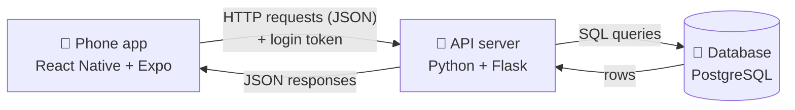
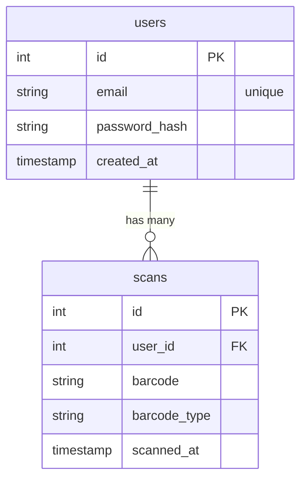

# How the SafeBite prototype works

This prototype proves three things SafeBite's MVP depends on:

1. The phone camera can reliably read grocery barcodes.
2. People can have their own accounts, with passwords handled safely.
3. The phone, the Flask server, and the PostgreSQL database can all talk to
   each other, so a scan on the phone ends up saved under the right user.

It does not yet look up ingredients or flag triggers. Those come next, and
they plug into exactly the pieces built here.

---

## The three layers

| Layer | Technology | Its job |
|---|---|---|
| Mobile app | React Native, Expo | Screens, camera, remembers who's logged in |
| API server | Python, Flask | Checks passwords, issues login tokens, decides who can see what |
| Database | PostgreSQL | Permanently stores users and scans |

The phone never talks to the database directly. Everything goes through
Flask, which is where the rules live ("you can only see your own scans").
If the app talked straight to the database, anyone who took the app apart
could read everyone's data.

---

## What happens, step by step

### Creating an account

1. You type an email and password on the login screen and tap
   **Create account**.
2. The app checks the obvious things first (both filled in, password 8+
   characters) so you get instant feedback without waiting on the network.
3. The app sends `POST /api/register` with the email and password.
4. Flask checks everything again. It can't trust the app alone, because
   anyone could send requests to the server without using the app.
5. Flask **hashes** the password (see "Security choices" below) and saves a
   new row in the `users` table.
6. Flask creates a **login token** and sends it back along with your user
   info.
7. The app stores that token in the phone's secure keychain and switches to
   the scanner screen.

### Logging in

Same as above, but `POST /api/login`. Flask hashes the password you typed
the same way and compares it to the stored hash. If they match, you get a
token. If either the email or the password is wrong, you get the same
"Email or password is incorrect" message, on purpose, so the login form
can't be used to find out which emails have accounts.

### Scanning a barcode

1. `expo-camera`'s `CameraView` watches the camera feed and fires
   `onBarcodeScanned` when it recognizes a barcode (UPC-A, UPC-E, EAN-13,
   EAN-8, Code 128, or QR).
2. The camera fires many times per second while a barcode is in view, so
   the app uses a lock (`isScanLockedRef`, a React ref) to act on only the first
   one. A ref is used instead of state because state updates aren't
   instant, and a second scan could slip through in the gap.
3. The app sends `POST /api/scans` with the barcode and its format, plus
   the login token in the `Authorization` header.
4. Flask reads the token to figure out which user is asking, then saves a
   row in the `scans` table linked to that user.
5. The app shows "Saved to your history" and adds the scan to the top of
   the Recent scans list.

### Reopening the app

On launch, the app looks in the secure keychain for a saved token. If it
finds one, it calls `GET /api/me` to confirm the token is still valid and
skips the login screen. If the server says the token is bad or expired, the
app deletes it and shows the login screen.

---

## The API

| Method | Path | Login needed | What it does |
|---|---|---|---|
| GET | `/api/health` | No | Returns `{"status": "ok"}` if the server is up |
| POST | `/api/register` | No | Creates an account, returns a token |
| POST | `/api/login` | No | Checks credentials, returns a token |
| GET | `/api/me` | Yes | Returns the logged-in user |
| POST | `/api/scans` | Yes | Saves one scanned barcode |
| GET | `/api/scans` | Yes | Returns your 20 most recent scans |

Every error comes back in one shape, `{"error": "message"}`, with a
standard HTTP status code (400 bad input, 401 not logged in, 409 email
already taken). The app shows the message directly, so the server's error
text is written for users to read.

## The database

Each scan points at the user who made it through `user_id`. That link is
what lets Flask answer "give me only *my* scans."

The tables are defined as Python classes in `backend/models.py`. A library
called SQLAlchemy translates them into PostgreSQL tables and turns Python
code like `Scan.query.filter_by(user_id=5)` into SQL, so there's no
hand-written SQL in the project yet.

---

## Security choices (and why)

**Passwords are hashed, never stored.** A hash is a one-way scramble: easy
to compute from the password, practically impossible to reverse. The
database only ever holds something like `scrypt:32768:8:1$...`. If the
database leaked, the real passwords still wouldn't. This uses Werkzeug's
`generate_password_hash`, which comes with Flask.

**Login tokens (JWTs) instead of sending the password every time.** After
you log in, the server hands the app a signed token that says "this is user
#5" and expires in 7 days. The app sends that token with each request. The
server signs tokens with `JWT_SECRET_KEY`, so a token can't be forged or
edited without that secret. This is why the secret belongs in `.env` and
never in GitHub.

**Tokens live in the secure keychain.** `expo-secure-store` saves the token
in the iOS Keychain / Android Keystore, which is encrypted and walled off
from other apps.

**The server decides what you can see.** Every scan request looks up the
user from the token, never from anything the app claims. Even if someone
edited the app to ask for another user's scans, the server would only
return their own.

**Known shortcuts for a prototype** (fine for a demo, to fix before real
users): traffic is plain `http`, not encrypted `https`; there's no limit on
login attempts; there's no "forgot password" flow.

---

## File tour

### Backend (`backend/`)

| File | What's in it |
|---|---|
| `app.py` | All six API routes, token setup, and `create_app()`, which wires Flask, the database, and JWT together |
| `models.py` | The `User` and `Scan` tables, plus password hashing helpers |
| `test_app.py` | 10 automated tests: sign-up rules, login success and failure, token checks, scans saving correctly, users not seeing each other's scans |
| `requirements.txt` | Python packages to install |
| `.env.example` | Template for your private settings (database address, token secret) |

### Mobile app (`mobile/`)

| File | What's in it |
|---|---|
| `App.js` | The root. Checks for a saved login on launch and shows either the login screen or the scanner |
| `src/screens/AuthScreen.js` | Login and create-account form (one screen, two modes) |
| `src/screens/ScannerScreen.js` | Camera, scan result card, and Recent scans list |
| `src/api.js` | Every call to the backend, in one place, with shared error handling |
| `src/config.js` | Figures out the backend's address (see below) |
| `src/theme.js` | Colors, matching the pitch deck |
| `app.json` | Expo settings, including the camera permission message users see |

**How the app finds your laptop.** On your phone, `localhost` means the
phone itself, not your laptop. Expo already knows your laptop's Wi-Fi
address, because that's how it sends the app to your phone. `config.js`
borrows that address and swaps in port 5001, so there's no IP address to
type in. You can override it with `MANUAL_BACKEND_URL` in `config.js`, or by starting Expo with `EXPO_PUBLIC_API_URL` set.

---

## Where this goes next

The pieces for the rest of the MVP attach directly to what's here:

- **Ingredient lookup.** When a scan comes in, Flask looks the barcode up
  in an open food database and stores the ingredient list. This is a new
  step inside the existing `POST /api/scans` route.
- **Trigger profile.** A new `trigger_ingredients` table linked to `users`,
  with a screen in the app to pick conditions and add personal triggers.
- **Match and flag.** A Python function that compares a product's
  ingredients to the user's triggers and returns safe / caution / avoid.
  The scanner's result card already has a place for it to show up.
- **History.** Already working. It will show the verdict next to each scan
  once match and flag exists.

