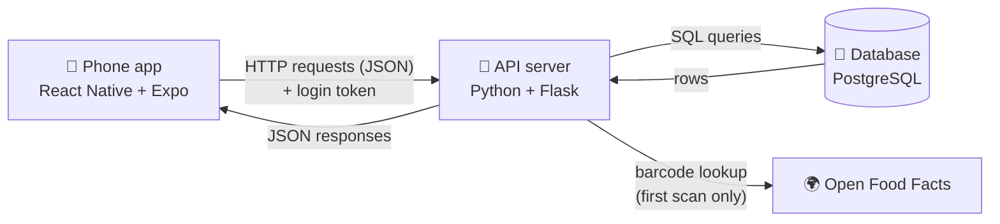
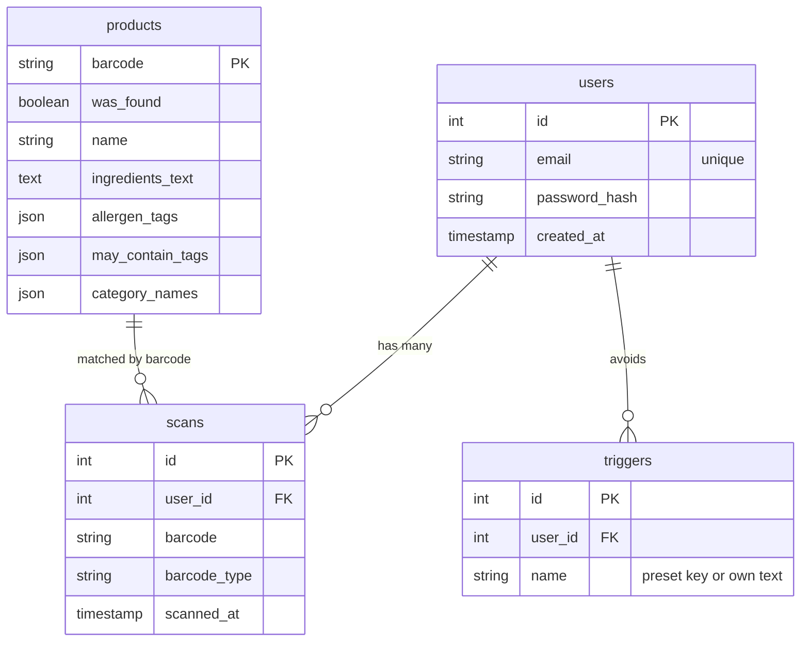

# How SafeBite works

The midterm MVP does four things:

1. People can have their own accounts, with passwords handled safely.
2. Each person keeps a profile of the ingredients they need to avoid.
3. The phone camera reads a grocery barcode (or the person types it in).
4. The backend looks up the product's ingredients, compares them to that
   person's profile, and returns **Avoid**, **Caution**, or **Safe** with the
   reasons. Every scan is saved to their history.

---

## The three layers

| Layer | Technology | Its job |
|---|---|---|
| Mobile app | React Native, Expo | Screens, camera, remembers who's logged in |
| API server | Python, Flask | Checks passwords, issues login tokens, decides who can see what |
| Database | PostgreSQL | Permanently stores users and scans |

The phone never talks to the database directly. Everything goes through
Flask, which is where the rules live ("you can only see your own scans").
If the app talked straight to the database, anyone who took the app apart
could read everyone's data.

---

## What happens, step by step

### Creating an account

1. You type an email and password on the login screen and tap
   **Create account**.
2. The app checks the obvious things first (both filled in, password 8+
   characters) so you get instant feedback without waiting on the network.
3. The app sends `POST /api/register` with the email and password.
4. Flask checks everything again. It can't trust the app alone, because
   anyone could send requests to the server without using the app.
5. Flask **hashes** the password (see "Security choices" below) and saves a
   new row in the `users` table.
6. Flask creates a **login token** and sends it back along with your user
   info.
7. The app stores that token in the phone's secure keychain and switches to
   the scanner screen.

### Logging in

Same as above, but `POST /api/login`. Flask hashes the password you typed
the same way and compares it to the stored hash. If they match, you get a
token. If either the email or the password is wrong, you get the same
"Email or password is incorrect" message, on purpose, so the login form
can't be used to find out which emails have accounts.

### Scanning a barcode

1. `expo-camera`'s `CameraView` watches the camera feed and fires
   `onBarcodeScanned` when it recognizes a barcode (UPC-A, UPC-E, EAN-13,
   EAN-8, Code 128, or QR).
2. The camera fires many times per second while a barcode is in view, so
   the app uses a lock (`isScanLockedRef`, a React ref) to act on only the first
   one. A ref is used instead of state because state updates aren't
   instant, and a second scan could slip through in the gap.
3. The app sends `POST /api/scans` with the barcode and its format, plus
   the login token in the `Authorization` header. Typing a barcode on the
   Scan tab sends the exact same request.
4. Flask reads the token to figure out which user is asking.
5. `services/food_lookup.py` checks the `products` table. If this barcode
   has never been looked up, it asks Open Food Facts and saves the answer,
   including "not found." Saved products are reused, so the second scan of
   anything is instant and still works if Open Food Facts is down.
6. `services/matching.py` compares the ingredients to the user's triggers
   and builds the verdict and reasons (see the README's "How a verdict is
   decided").
7. Flask saves a row in the `scans` table and sends back the scan, the
   product, the verdict, and the reasons.
8. The app shows them in `ScanResult.js`: a colored verdict banner, the
   product, a "Why" list, and the ingredients.

### Setting up a profile

The Profile tab asks `GET /api/profile` for the user's triggers and the
preset options, and draws each preset as a chip. Tapping a chip or adding
your own sends the *whole* list with `PUT /api/profile`, which replaces the
old one. It saves right away, so there's no Save button to forget. If a save
fails, the list goes back to the last version that saved.

### Viewing history

`GET /api/scans` returns the 20 newest scans. Verdicts aren't stored. They're
worked out fresh from the saved product and the user's *current* triggers,
so changing your profile updates your whole history.

### Finding safer swaps

On an Avoid or Caution result, `SaferSwaps.js` shows a "Find safer swaps"
button. Tapping it calls `GET /api/products/<barcode>/swaps`:

1. Flask looks at the product's saved categories (general to specific, like
   `["Spreads", "Hazelnut spreads"]`) and searches Open Food Facts for other
   products in the most specific one, sold in the US, most-scanned first.
2. Each result gets saved to `products` (so scanning it later is instant) and
   run through the same matching engine as a normal scan.
3. Only the ones that come back **Safe** for this user get sent back, up to 3.
   If none are safe, it tries one category broader before giving up.

Tapping a swap checks it like a normal scan, so it shows up in history too.

### Reopening the app

On launch, the app looks in the secure keychain for a saved token. If it
finds one, it calls `GET /api/me` to confirm the token is still valid and
skips the login screen. If the server says the token is bad or expired, the
app deletes it and shows the login screen.

---

## The API

| Method | Path | Login needed | What it does |
|---|---|---|---|
| GET | `/api/health` | No | Returns `{"status": "ok"}` if the server is up |
| POST | `/api/register` | No | Creates an account, returns a token |
| POST | `/api/login` | No | Checks credentials, returns a token |
| GET | `/api/me` | Yes | Returns the logged-in user |
| GET | `/api/profile` | Yes | Your triggers, plus the preset options |
| PUT | `/api/profile` | Yes | Replaces your list of triggers |
| POST | `/api/scans` | Yes | Looks up a barcode, checks it, and saves it |
| GET | `/api/scans` | Yes | Your 20 most recent scans, with verdicts |
| GET | `/api/products/<barcode>/swaps` | Yes | Up to 3 similar products that are Safe for you |

Every error comes back in one shape, `{"error": "message"}`, with a
standard HTTP status code (400 bad input, 401 not logged in, 409 email
already taken). The app shows the message directly, so the server's error
text is written for users to read.

## The database

Each scan points at the user who made it through `user_id`. That link is
what lets Flask answer "give me only *my* scans."

The tables are defined as Python classes in `backend/models.py`. A library
called SQLAlchemy translates them into PostgreSQL tables and turns Python
code like `Scan.query.filter_by(user_id=5)` into SQL, so there's no
hand-written SQL in the project yet.

The tables themselves get built and changed by **migrations** (Flask-Migrate)
in `backend/migrations/versions/`, one small file per change. `python app.py`
runs whichever ones haven't run yet, so the database never has to be wiped
when a table changes.

---

## Security choices (and why)

**Passwords are hashed, never stored.** A hash is a one-way scramble: easy
to compute from the password, practically impossible to reverse. The
database only ever holds something like `scrypt:32768:8:1$...`. If the
database leaked, the real passwords still wouldn't. This uses Werkzeug's
`generate_password_hash`, which comes with Flask.

**Login tokens (JWTs) instead of sending the password every time.** After
you log in, the server hands the app a signed token that says "this is user
#5" and expires in 7 days. The app sends that token with each request. The
server signs tokens with `JWT_SECRET_KEY`, so a token can't be forged or
edited without that secret. This is why the secret belongs in `.env` and
never in GitHub.

**Tokens live in the secure keychain.** `expo-secure-store` saves the token
in the iOS Keychain / Android Keystore, which is encrypted and walled off
from other apps.

**The server decides what you can see.** Every scan request looks up the
user from the token, never from anything the app claims. Even if someone
edited the app to ask for another user's scans, the server would only
return their own.

**Known shortcuts for a prototype** (fine for a demo, to fix before real
users): traffic is plain `http`, not encrypted `https`; there's no limit on
login attempts; there's no "forgot password" flow.

---

## File tour

### Backend (`backend/`)

| File | What's in it |
|---|---|
| `app.py` | All nine API routes, the `@login_required` helper they share, token setup, `create_app()`, and `prepare_database()`, which runs migrations |
| `migrations/` | Every change to the tables, in order (Flask-Migrate) |
| `models.py` | The `User`, `Scan`, `Trigger`, and `Product` tables, plus password hashing helpers |
| `services/matching.py` | The preset triggers, their other names and look-alikes, and the rules for Avoid / Caution / Safe |
| `services/food_lookup.py` | Asks Open Food Facts about a barcode, searches for similar products, and saves what comes back |
| `test_app.py` | Tests for accounts, profiles, scanning, caching, and history |
| `test_matching.py` | A test for every verdict rule |
| `test_food_lookup.py` | Tests for reading Open Food Facts' responses and searches |
| `test_migrations.py` | Tests that migrations match the models and upgrade old databases safely |
| `requirements.txt` | Python packages to install |
| `.env.example` | Template for your private settings (database address, token secret) |

### Mobile app (`mobile/`)

| File | What's in it |
|---|---|
| `App.js` | The root. Checks for a saved login on launch, then shows the login screen or the three tabs |
| `src/screens/AuthScreen.js` | Login and create-account form (one screen, two modes) |
| `src/screens/ScannerScreen.js` | Keeps track of the scan steps (ready, checking, done, failed) and shows the right piece for each |
| `src/screens/HistoryScreen.js` | Recent scans with verdict badges; tap to see why; pull to refresh |
| `src/screens/ProfileScreen.js` | Trigger chips, your own triggers, account, and log out |
| `src/components/ScanResult.js` | The verdict banner, product, reasons, and ingredients |
| `src/components/SaferSwaps.js` | The "Find safer swaps" button and the list of swaps |
| `src/components/CameraScanner.js` | The live camera and its aiming frame |
| `src/components/TypeBarcodeBox.js` | The "type a barcode" box and its checks |
| `src/components/PanelMessage.js` | Messages on the dark scan panel, like "Checking ingredients…" |
| `src/components/TabBar.js` | The Scan / History / Profile bar |
| `src/components/VerdictBadge.js` | The small colored verdict pill in History |
| `src/components/ScreenHeader.js` | The title at the top of each tab |
| `src/api.js` | Every call to the backend, in one place, with shared error handling |
| `src/config.js` | Figures out the backend's address (see below) |
| `src/theme.js` | Colors, matching the pitch deck |
| `app.json` | Expo settings, including the camera permission message users see |

**How the app finds your laptop.** On your phone, `localhost` means the
phone itself, not your laptop. Expo already knows your laptop's Wi-Fi
address, because that's how it sends the app to your phone. `config.js`
borrows that address and swaps in port 5001, so there's no IP address to
type in. You can override it with `MANUAL_BACKEND_URL` in `config.js`, or by starting Expo with `EXPO_PUBLIC_API_URL` set.

---

## Where this goes next

- **Safe foods list.** A `saved_foods` table and a "Save" button on Safe
  results.
- **Recipe suggestions.** A small set of recipes tagged by ingredient,
  filtered with the same matching engine used for scans.
- **Typing in an ingredient list** for products Open Food Facts doesn't have.
- **A hosted backend** with HTTPS, so the app works without a laptop.
